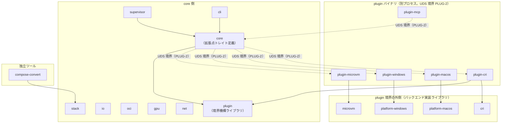
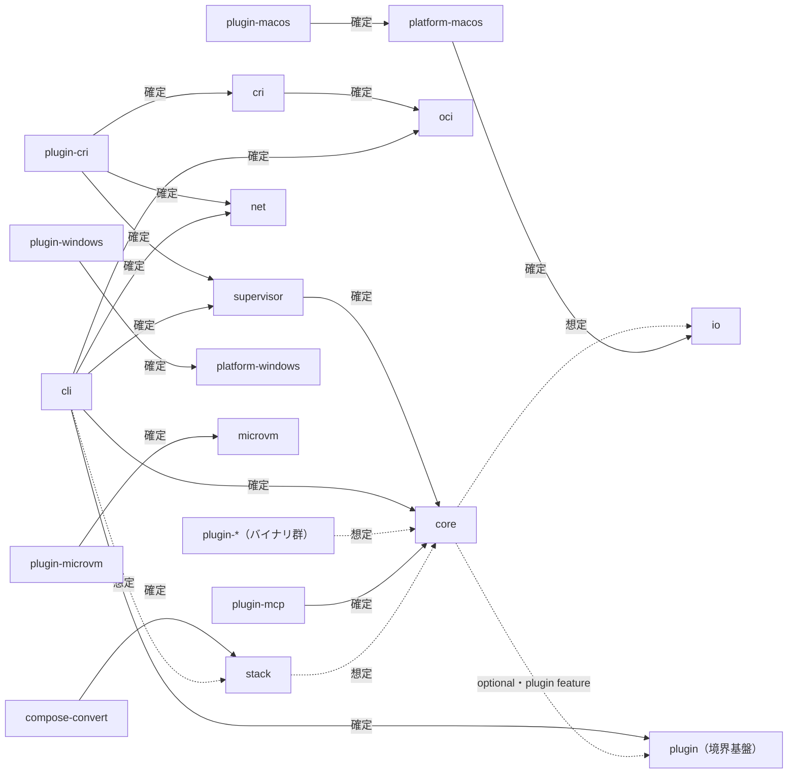

# アーキテクチャ

crate 境界・依存方向・実装コードを持たない確定済み設計判断への索引となる文書（REPAIR-3）。個々の crate の責務・PLUG-1 区分の確定一覧は [crate-naming.md](design/crate-naming.md) を正とし、本書ではそれを層構造・依存方向の観点で要約する。

- 作成日: 2026-09-27
- 関連 issue: #21（TASK-6）・#22（TASK-6.1・本書）・#23（TASK-6.2）・#24（TASK-6.h1）・#30（TASK-72）
- ステータス: #24（TASK-6.h1）で内容レビュー承認待ち
- 対象ビヘイビア: REPAIR-3・PLUG-1（crate 分割の前提として REPAIR-1 も参照）・WIN-6
- 対象マイルストーン: MS-0

spec（`docs/spec/04-behavior/`）と本書の記述が食い違う場合は spec を正とする（[spec-reference](../.claude/rules/spec-reference.md)）。

## crate 境界

workspace は次の層に分けられる。

1. **境界基盤**: `plugin`（`fandhe-container-plugin`）。plugin 境界機構（UDS・長さ接頭辞フレーム・gRPC）を提供し、core 側・plugin 側の双方から依存される
2. **I/O 共有層**: `io`。バッチ write-back・フラッシュバリア・FS 正規化を提供する
3. **実行層**: `core`。namespace・cgroups v2・seccomp/Landlock・rootless・拡張点トレイト（`ContainerRuntime`・`StateStore`・`NetworkPlugin`・`VolumeProvider`）を持つ
4. **実行層を使う core 側 crate**: `supervisor`（コンテナごとの監視プロセス）・`oci`（イメージ管理）・`gpu`（CDI）・`net`（netlink/nftables）・`stack`（TOML スキーマ）
5. **入口**: `cli`（統一 CLI）。独立ツールとして `compose-convert`（`compose.yaml` → TOML 変換）が別枠である
6. **plugin 境界の外側（バックエンド実装ライブラリ）**: `cri`・`platform-macos`・`platform-windows`・`microvm`。PLUG-1 上は「core」ではなく、対応する plugin バイナリから呼ばれる実装本体
7. **plugin バイナリ（別プロセス）**: `plugin-cri`・`plugin-macos`・`plugin-windows`・`plugin-microvm`・`plugin-mcp`。UDS 境界（PLUG-2）を越えて 6. の実装ライブラリを動かす

`guest-init`（`fandhe-container-guest-init`）は macOS ゲスト VM の initrd に入れる PID 1 で、ホスト側の層には属さない「ゲスト資産」である（crate-naming.md の表 #20。#1823・#1875）。通常の依存を持たず（std のみ）、`platform-macos` への依存は契約の照合試験（`tests/contract.rs`）のための `[dev-dependencies]` のみ。

`benches`（`fandhe-container-benches`）は上記いずれの層にも属さない、crate をまたぐベンチ回帰専用の `publish = false` workspace メンバーである（crate-naming.md 決定 7）。

### crate 一覧の要約表

短縮名・crate 名・PLUG-1 区分の確定一覧は [crate-naming.md](design/crate-naming.md) の表を参照する（本書での重複転記はしない）。層との対応のみ以下に示す。

| 層 | crate（短縮名） |
| ---- | ---- |
| 境界基盤 | plugin |
| I/O 共有層 | io |
| 実行層 | core |
| 実行層を使う core 側 | supervisor・oci・gpu・net・stack |
| 入口 | cli |
| 独立ツール | compose-convert |
| plugin 境界の外側（バックエンド実装） | cri・platform-macos・platform-windows・microvm |
| plugin バイナリ | plugin-cri・plugin-macos・plugin-windows・plugin-microvm・plugin-mcp |
| ゲスト資産（ホスト側の層の外） | guest-init |
| ベンチ専用 | benches |

### crate 境界図



実線は「設計上の依存方向」（Cargo 依存関係。現状の `Cargo.toml` にはまだ実装されていない辺を含む。「依存関係グラフ」節を参照）を示し、点線は「UDS 境界（PLUG-2）」ラベルを付した、UDS 境界を越える呼び出し関係のみを示す。`core --> plugin_lib`・`plugin_cri --> plugin_lib`（境界基盤ライブラリへの依存。crate-naming.md 表 #10「core・plugin 双方が依存する境界基盤ライブラリ」）は UDS 呼び出しではなく Cargo 依存関係のため実線で描く。plugin 境界の外側（バックエンド実装ライブラリ）は plugin バイナリからのみ呼ばれ、core 側からは直接依存しない。 `plugin` feature を除外した core のビルドとサイズ記録は [plugin-feature-size-record](design/plugin-feature-size-record.md)（PLUG-3・TASK-111.2）を参照。

## インターフェース契約（拡張点トレイト）

TASK-4（CRI-7）で定義した 4 つの拡張点トレイトは、いずれも定義ファイルが `crates/core/src/traits/` にある。シグネチャの二重管理を避けるため、詳細は各ファイルの rustdoc を参照する（本書では複製しない）。

| トレイト | 定義ファイル | 実装の置き場所（PLUG-1） |
| -------- | ------------ | ------------------------ |
| `ContainerRuntime` | `crates/core/src/traits/container_runtime.rs` | plugin 側（別プロセス＋UDS。`fandhe-container-plugin-cri` 等） |
| `NetworkPlugin` | `crates/core/src/traits/network_plugin.rs` | plugin 側（別プロセス＋UDS） |
| `StateStore` | `crates/core/src/traits/state_store.rs` | core に既定実装（ファイルベース）。別実装は plugin で差し替え可能 |
| `VolumeProvider` | `crates/core/src/traits/volume_provider.rs` | core 側（定義・実装とも。データパス直結のため plugin 境界を持たない。D-14） |

共通型（`ContainerId`・`ErrorCode`・`TraitError` 等）は `crates/core/src/traits/types.rs` に置く。

plugin 境界のワイヤー形式（別プロセス＋長さ接頭辞フレーム、ペイロード serde_json、wire 互換が要る場面のみ gRPC）は PLUG-2 として ID のみ参照する。詳細な実装は TASK-107 系（`plugin` crate 本体）で行う。

plugin プロセスのライフサイクル（PLUG-7）では、親（core 側の proxy 等）が SIGKILL・abort で落ちた場合も plugin 本体が孤児で残らないよう、Linux では `PR_SET_PDEATHSIG`（SIGKILL）を spawn 時に設定する（#1514・#1403 の方式 B。REPAIR-5・CORE-1）。効くのは直接の子だけで、発火条件は子を fork したスレッドの終了のため、常駐 plugin はセッションより長く生きるスレッドから起動する契約とする。孫プロセスは PR #1397・#1513（プロセスグループ回収・シグナル転送）で扱う。macOS には同等の機構がなく残留し得る（kqueue `NOTE_EXIT` は将来課題）。Windows では起動役の補助は plugin ではなく、ゲスト内の core は Linux の規則に乗る（推奨案・承認待ち。[windows-execution-layout.md](design/windows-execution-layout.md)）。

## 依存関係グラフ

### 現状（Cargo.toml の実測）

workspace 内 crate 間の依存辺は、実装が進んだ TASK から順に `Cargo.toml` へ追加されている（例: `cli` → `net`、`platform-macos` → `io`）。網羅的な一覧は下記の確認コマンドで取得する。

確認コマンド:

```bash
cargo metadata --format-version 1 --no-deps | jq '[.packages[] | {name, deps: [.dependencies[].name]}]'
```

依存は各 TASK の実装が進むにつれて追加される。追加時は「設計上の依存方向」の表を更新する。

なお `plugin` → `cri` は `[dev-dependencies]` のみの test 専用辺（TASK-108.3・#455。生成済み CRI サービスの UDS 疎通試験用）で、通常依存の方向規則（plugin が最下位の境界基盤）と PLUG-4 の core 不変性は変えない。cri → plugin の通常依存は足さない。

### 設計上の依存方向

以下は各 TASK・crate-naming.md の決定に基づく設計上の依存方向であり、現状の `Cargo.toml` には未反映の辺を含む。各辺には「確定（出典）」「想定（未確定・該当 TASK で確定）」「未確定（方向を決めない）」のいずれかのラベルを付ける。



| 依存元 → 依存先 | 根拠 | 状態 |
| ---------------- | ---- | ---- |
| `compose-convert` → `stack` | crate-naming.md 決定 5（TOML の型は `stack` のものを使う） | 確定 |
| `guest-init` →(dev) `platform-macos` | ゲスト init と `guest_mount` の契約の機械照合（`tests/contract.rs`。MAC-1・#1875。dev-dependencies のみで、通常の依存には入れない。外部クレートの追加ではない） | 確定 |
| `oci` →(dev) `core` | 実機前提ハーネス `tests/pull_e2e.rs` の実行段が TASK-29 の `create` / `start` と `ProductionLauncher` を使う（OCI-1・TASK-55.1・#420。dev-dependencies のみで、通常の依存には入れない。外部クレートの追加ではない。将来 `core` が `oci` に通常依存すると dev 循環になるため、その時はハーネスの置き場所を見直す） | 確定 |
| `core` →(通常) `oci` は張らない | create / delete の OCI-7 参照登録・解除（TASK-183.8.1・#853・#2315）は、core が `oci_runtime::ContainerImageRefs`（依存注入のトレイト。`register` / `release` / `bind` / `registration` / `release_if` の 5 メソッド）を定義する。参照には登録ごとに採番する世代（oci の `ContainerRefGeneration` と core の `ImageRefGeneration`。`from_raw` / `as_raw` で写す）と確定・未確定の状態があり、メソッドは `ImageStore` の `register_container_ref`（未確定で登録する。`Registered` / `AlreadyRegistered` を返し、世代は返さない）・`release_container_ref`（ID 指定。create の失敗経路の巻き戻し用）・`bind_container_ref`（状態作成の成功直後に確定し、世代を返す）・`container_ref_registration`（確定済みの世代だけを返す）・`release_container_ref_if`（世代が一致するときだけ外す。delete 用）に対応する。未確定のまま残った参照の回収（`release_unbound_container_ref_if`・`reconcile_container_refs`）は再起動時の照合（#854・TASK-183.8.2）が起動点を持ち、トレイトには含めない（本番 probe と起動時の配線はアダプタ側の担当）。このトレイトを満たす本番アダプタ（`StoreImageRefs`。`crates/cli/src/commands/image_refs.rs`）は、oci と core の両方に通常依存する上位 crate に置く。置き場所のオーナー判断は #2315 で未取得で、既存の `cli → oci`・`cli → core` の辺だけで足りる cli に暫定で置いた（新しい辺は無い。別 crate に決まったらそのまま移せる）。`create --image-root <dir> --image <digest または name[:tag]>`（タグ参照は永続化済みの在庫から digest へ解決する。#2496）と `delete`（`--image-root <dir>` は任意で、省くと create が状態記録へ残したストア root から解除する。#2499）が配線する（レイヤー展開は #2377、manifest の在庫・タグ・リースの永続化は #2380 で実装済み）。core の依存ツリーに oci の通信・展開系クレートを入れず、`pull_e2e` の dev 依存との循環も作らないため。`oci` の結合試験 `tests/container_image_refs.rs` は dev 依存の core で試験用アダプタを使う | 確定 |
| `supervisor` → `core` | crate-naming.md 決定 6（`StateStore` 既定実装を core に一本化。supervisor は 2 つ目の実装を持たない） | 確定 |
| `plugin-cri` → `cri` | crate-naming.md 表 #15（`cri` の実装を別プロセス化。TASK-114）。`adapter` が `CriRuntimeService` を組み立てる（TASK-114.2・#458。workspace 内 path 依存で外部クレートの追加なし） | 確定 |
| `plugin-cri` → `core` | `adapter` が `ContainerRuntime`・`StateStore`・`NetworkPlugin` の実装を選んで注入し、`oci_runtime`・`state_store` のライブラリ関数を使う（CRI-7・PLUG-1・TASK-114.2・#458。`default-features = false`・workspace 内 path 依存で外部クレートの追加なし）。core・cri から plugin-cri への辺は無い | 確定 |
| `cri` → `oci` | `PullImage` が oci の pull 経路（認証・manifest・blob 取得・digest 検証）を呼ぶ（CRI-4・OCI-1・TASK-61.3・#446。workspace 内 path 依存で実装済み。外部クレートの追加ではない）。向きはバックエンド実装ライブラリ → core 側で、規則 2 の逆向き（core 側が `cri` に依存しない）のため抵触しない | 確定 |
| `cri` → `core` | `RuntimeAdapter` が `ContainerRuntime` トレイト（`traits` のみ。具象の実行層は参照しない）を呼ぶ（CRI-2・CRI-7・TASK-59.1・#437。workspace 内 path 依存・`default-features = false` で外部クレートの追加なし）。向きはバックエンド実装ライブラリ → core 側で、規則 2 の逆向き（core 側が `cri` に依存しない）のため抵触しない | 確定 |
| `plugin-macos` → `platform-macos` | crate-naming.md 表 #16（TASK-115） | 確定 |
| `plugin-windows` → `platform-windows` | crate-naming.md 表 #17（TASK-116）。plugin-windows の位置づけ（起動役の補助への作り替え）は [windows-execution-layout.md](design/windows-execution-layout.md) で承認待ち | 確定（Windows 部分は設計ドラフト・承認待ち） |
| `plugin-microvm` → `microvm` | crate-naming.md 表 #18（TASK-117） | 確定 |
| `plugin`（境界基盤） | crate-naming.md 表 #10（core 側・plugin 側双方が依存する境界基盤） | 確定（依存の向きは双方向的な基盤利用であり、上記フローチャートでは個別の辺として描かない） |
| `core` → `io` | `VolumeProvider`（core 実装）がデータパスで I/O 共有層を使う想定（D-14。G2/G3 で確定。担当 TASK と時期は #2451 で判断待ち: [volume-provider-implementation.md](design/volume-provider-implementation.md)） | 想定 |
| `cli` → `core` | 統一 CLI が実行層を呼ぶ。Linux は core を直接、macOS は core の plugin 発見・登録機構（PLUG-4）経由で（Windows は、ゲスト内の CLI が core を直接呼ぶ Linux の経路を使い、ホストの CLI は隣の起動役の補助を起動するだけにする案。承認待ち。[windows-execution-layout.md](design/windows-execution-layout.md)）、platform-* / microvm 系へは直接依存しない（`make check-cli-backend-deps` で normal / build / dev 辺・全ターゲットを機械判定。TASK-79.2〜79.4） | 確定（Windows 部分は設計ドラフト・承認待ち） |
| `cli` → `supervisor` | `start` が supervisor の bin を起動し、結果の 1 行を契約の型（`start_contract::StartReport`）で復号する。`logs` が `logs::read_container_log` でコンテナログ（`<state_root>/@container-logs`）を読む（#1543・CLI-1・SUP-7）。pull 時の展開の所有者は start と同じ `id_model::resolve_rootless_id_source` で解決する（cli の `image_ownership`。#2389・SEC-5・CORE-6）。実行ファイルの固定名（`launcher::SUPERVISOR_FILE_NAME`）もここから得る。`start` の起動・受信の実装は `supervisor::start_client`、`stop` / `delete` の signaler・cgroup remover は `supervisor::control` / `supervisor::cgroup_remover` にあり、plugin-cri と共有する（#2434。CLI は薄い呼び出し層）（TASK-79 追補・#1718・REPAIR-2。workspace 内 path 依存で実装済み。外部クレートの追加ではない。supervisor は core にのみ依存し循環しない） | 確定 |
| `cli` → `oci` | `image ls`・`system df`・`image rm [--force]`・`image tag` が oci の管理 API（`image_management`）を呼ぶ（#2221・#2316・CLI-1・OCI-7・TASK-183。workspace 内 path 依存で実装済み。外部クレートの追加ではない。oci は cli に依存せず循環しない）。あわせて `create --image-root --image` / `delete`（`--image-root` は任意。#2499）が OCI-7 のコンテナ参照の登録・解除に `ImageStore` を使う（#2315。アダプタは cli 内）。コンテナ参照（#2341・#2352）と manifest の在庫・タグ・リース（#2380）は永続化済みだが、本番で在庫を埋める経路（pull → `ImageStore` の配線）が未実装のため、現状の観測値は `image ls` がヘッダのみ・`image rm` / `image tag` / `create --image` が `NOT_FOUND` | 確定 |
| `platform-macos` → `io` | virtiofs 共有の I/O 共有プロトコルクライアント（`PipelineClient`）を使う（MAC-1・TASK-65.2。workspace 内 path 依存で実装済み。外部クレートの追加ではない）。向きはバックエンド → core 側で、規則 2 の逆向きのため抵触しない | 確定 |
| `cli` → `net` | `doctor` が br_netfilter・ホストの `ip filter FORWARD` policy の判定材料を net の読み取り照会（GETCHAIN）で取得する（NET-10・TASK-148.1。workspace 内 path 依存で実装済み。組み合わせ判定・警告・DOCKER-USER 案内・終了コードの評価層は TASK-148.2 で実装済み。CLI 配線は TASK-79） | 確定 |
| `cli` → `plugin`（境界基盤） | バイナリ `fandhe-container` が受けた SIGINT・SIGTERM・SIGHUP を、起動中の plugin へ転送する API（`signal_forward`）を呼ぶ。シグナルハンドラの登録はバイナリの責務（PLUG-7・#1513・#1403。workspace 内 path 依存で実装済み。外部クレートの追加ではない）。`plugin` は境界基盤で `plugin-*` バイナリ crate ではないため規則 2 に抵触しない | 確定 |
| `cli` → `stack` | 統一 CLI が TOML スキーマを呼ぶ想定（G6・TASK-155） | 想定 |
| `plugin-mcp` → `core` | `tools/call` の `list_containers` が core の `FileStateStore`（OCI-5）を読む（MCP-2・TASK-118.3・#466。workspace 内 path 依存で実装済み。外部クレートの追加ではない）。向きはバックエンド → core で、規則 2 の逆向きのため抵触しない。他の `plugin-*` は個別に確定するまで下行の想定のまま | 確定 |
| `plugin-mcp` → `plugin`（境界基盤） | core が bind した UDS へ peer 認証つき（`UdsStream::connect`）で接続して JSON-RPC を処理する（PLUG-12・MCP-1・TASK-118.4・#467。workspace 内 path 依存で実装済み。外部クレートの追加ではない。core 側 proxy との結線とフレーミングの確定は TASK-114） | 確定 |
| `plugin-*`（バイナリ群） → `core` | トレイト型（`ContainerRuntime` 等の共通型）を参照する想定（TASK-114〜118） | 想定 |
| `core` → `plugin`（境界基盤） | core の `plugin` feature（既定で有効）で optional 依存。`--no-default-features` で除外できる（PLUG-3・TASK-111.1・#262）。plugin 候補の探索は core 側の `crates/core/src/plugin_discovery.rs` に実装済み。登録の成果物も core 側に置く想定（TASK-109） | 確定（optional 辺。探索は実装済み・登録は未実装） |
| `stack` → `core` | `up` コマンドが core の CLI／ライブラリ API を呼ぶ想定（PLUG-1 境界表の stack 行・TASK-155） | 想定 |
| `supervisor` → `net` | rootless ネットワーク転送の pasta の起動・監視・回収をコンテナごとの supervisor が行う（NET-9・CORE-1・#1940。`net` は core 側のライブラリに確定〔2026-10-12 オーナー決定、[#4 のコメント](https://github.com/Fandhe-AI/fandhe-container/issues/4#issuecomment-6129145225)〕。辺は `Cargo.toml` にまだ無く、依存の向き・feature の切り方は #1870 の設計で決める） | 想定 |
| `plugin-cri` → `supervisor` | `CoreLifecycleRuntime` の `start`・`kill`・`stop` と `delete` の cgroup remover を CLI と同じ本番経路へ結線する（`supervisor::start_client`〔supervisor の bin の委譲 scope 起動と結果の受信〕・`control::production_signaler` / `production_stop_signaler`〔制御チャネル経由。stop の意図は SUP-9〕・`cgroup_remover`・`supervisor_log::remove_bounded`。CLI の private 実装を複製せず移設して共有した。#2434・CRI-2・PLUG-1・SUP-1・SUP-9・REPAIR-1。workspace 内 path 依存で外部クレートの追加なし。辺は一方向で、supervisor は core にのみ依存するため循環しない。supervisor が core を既定 feature〔`plugin`〕で引くため、`-p fandhe-container-plugin-cri` のビルドでは feature 統合で core の `plugin` feature が有効になる。PLUG-4 の core 不変性の判定は core 単体のビルドで行うため影響しない） | 確定 |
| `plugin-cri` → `net` | `NetworkPlugin` の実装（`netsetup`）が TASK-139 の統合 API（`create_network`・`attach_container`・`delete_network`）を呼ぶ（CRI-7・PLUG-1・NET-1〜NET-3・TASK-114.4・#460・MS-4。workspace 内 path 依存で外部クレートの追加なし。`net` は依存を持たない core 側ライブラリで、辺は一方向）。DNS ヘルパーの起動・停止（NET-5・NET-7）は未実装 | 確定 |
| `gpu` の GPU-1〜4 以外を含む辺 | GPU-5・7・8 は境界表に明示判定なし、GPU-9 は「検討中」（`api-gpu.md`） | 未確定 |
| macOS Venus（GPU-6）関連の辺 | 成果物は `plugin-macos` 側に置く定義のみが確定しており、依存の詳細な方向は未確定 | 未確定 |

### 一方向依存の規則

1. 循環依存を作らない
2. core 側 crate（`io`・`core`・`supervisor`・`oci`・`gpu`・`net`・`stack`・`cli`）は `plugin-*` バイナリ crate・バックエンド実装ライブラリ（`cri`・`platform-macos`・`platform-windows`・`microvm`）に依存しない
3. 複数 crate が共有する型は下位 crate（`core`）に置く
4. plugin の追加で core を変更しない（PLUG-4）。機械判定（core ソース sha256・`cargo tree -p <core> --locked -e normal`・core バイナリ sha256。crate-naming.md 決定 3）は TASK-109 で実装予定であり、本書・本 PR ではスクリプトを追加しない

## core / plugin 境界（PLUG-1）

D-14（方針追記 2）に基づく core / plugin の割り付け表を以下に転記する（PLUG-1）。出典は `docs/spec/04-behavior/plugin-system.md`「境界表」であり、記述が食い違う場合は spec を正とする。crate 単位の PLUG-1 区分は [crate-naming.md](design/crate-naming.md) を正とし、本節では重複させない。

| 対象 | 配置 | 根拠 |
| ---- | ---- | ---- |
| Linux ネイティブ実行層（`api-runtime-core.md`）・I/O 共有プロトコル（`api-io-share.md`）・OCI イメージ（`api-oci-image.md`）・CLI（`screen-cli.md`） | core | D-14 の core 範囲定義そのもの |
| `ContainerRuntime`（`api-cri.md` CRI-7） | plugin（トレイト定義は core、実装を別プロセスへ配置可能） | 制御面のみを扱い、Δp50=5.542μs（長さ接頭辞フレーム）で CORE-10/MAC-2 目標に無視できる影響（PoC-13。フレーム方式の値は bincode ペイロードでの計測値であり、serde_json 変更に伴い TASK-113 で再計測する） |
| `StateStore`（同上） | **core**（トレイト定義・ファイルベースの既定実装とも core。別実装〔分散ストア等〕は plugin として差し替え可能） | 既定実装は core、別実装は plugin で差し替え可能。CLI・supervisor・`create`/`delete` の全経路が使う状態ファイル（OCI-5）であり、plugin 未導入の最小構成でも状態管理を完結させ、常駐デーモンを持たない CORE-1 と整合させるため（ユーザー決定 2026-09-26）。別実装を plugin に出す場合のオーバーヘッドは制御面として許容範囲（PoC-13） |
| `NetworkPlugin`（同上） | plugin（同上） | 制御面（ネットワーク設定操作）でありデータパス（パケット転送そのもの）ではないため同様に許容範囲（PoC-13）。rootful のネットワーク設定（veth・bridge・nftables）もこの実装が `crates/net` を使って行い、core は network namespace を用意してその参照を渡すだけにする（CNI と同じ形。2026-10-15 オーナー決定、[#4 のコメント](https://github.com/Fandhe-AI/fandhe-container/issues/4#issuecomment-6200154873)） |
| `VolumeProvider`（同上） | **core**（トレイト定義・実装とも core に残す） | データパス（ファイル I/O）に接するため。gRPC 境界で PoC-2 batch 比 17.62%、フレーム境界でも 3.71% の劣化が数値で示された（PoC-13 データパス机上見積もり） |
| macOS バックエンド（`api-platform-macos.md`） | plugin（別プロセス、常駐/都度起動いずれも可） | MAC-2 上乗せが常駐 5.032ms（core-harness 起動＋UDS 接続＋4 RPC〔代表操作 A・B〕を含む保守的な値）・都度起動 2.537ms（いずれも 2 秒目標の 0.3%未満、PoC-13）。既定方式では VM ごとの保持役が plugin-macos を常駐で持ち、ゲスト内の core・supervisor・CLI へ中継する（設計のみ・未実装・承認待ち #1906。[macos-shared-vm.md](design/macos-shared-vm.md)） |
| Windows バックエンド（`api-platform-windows.md`） | WSL2 ゲスト内の core（Linux の経路をそのまま使う）＋ Windows ホストの薄い起動役（macOS と同型の「ホストの core と別プロセス plugin」の境界は置かない。#1415、WIN-1・PLUG-1・PLUG-11）。ゲスト内でしか namespace・cgroup・seccomp を適用できず状態ファイルもゲスト内に置く（OCI-5）ため、中継は `wsl.exe` で行う。起動役の crate と plugin-windows crate の扱いは承認待ち（[windows-execution-layout.md](design/windows-execution-layout.md)・#2230） | 上記と同様の制御面境界コストの見込み。実測は macOS 単独のため参考値（PoC-13、Linux/Windows での再確認は Phase 5 へ申し送り） |
| microVM（`api-microvm.md`） | plugin（起動・停止等の制御面のみ。VM 内部の I/O パスは対象外） | 制御面操作である限り上記と同様（PoC-13） |
| CRI サーバー（`api-cri.md`） | plugin | 制御面（`RunPodSandbox` 等）であり PoC-13 の代表操作 (A) そのもの |
| MCP サーバー（`api-mcp.md`） | plugin（`fandhe-container-plugin-mcp` として参照実装済み） | core 無変更で追加可能なことを実証（PoC-13 成功基準 3） |
| CDI の適用・OCI hook の実行（`api-gpu.md` GPU-1〜GPU-4） | core（2026-10-15 オーナー決定、[#4 のコメント](https://github.com/Fandhe-AI/fandhe-container/issues/4#issuecomment-6200154873)） | GPU の device node・mount・env 付与は汎用の mount／device 操作であり D-14 の core 範囲定義（Linux ネイティブ実行層）と整合する。hook はホスト権限でコンテナの rootfs を書き換える（ld キャッシュ更新等）ため、core 内で OCI hook（`createContainer` 相当）を実行する機能として実装する（D-15、gpu-passthrough-cdi〔PoC-14〕）。hook はコンテナ作成の途中（`/proc` のマウントの後・`pivot_root` の前）に実行する必要があり、plugin へ出すと起動の経路にプロセス間の往復が入るため core に置く。hook はホストの権限で動くため、タイムアウト（REPAIR-5）と実行ファイルのパスの検証を必須とする |
| rootless ネットワーク転送（`api-network.md` NET-9） | 例外として認める（2026-10-12 オーナー決定、#340） | ユーザー空間転送（pasta）はデータパス上で動作するプロセスだが、転送は外部ヘルパーのプロセスが担い、core⇔plugin の IPC 往復がデータパスに入るわけではない。この整理を D-14 の原則（plugin 境界をデータパスに置かない）の例外として認める。例外は rootless の経路に限り、rootful の経路（veth・bridge・nftables）は変えない。fandhe-container 側が持つのは pasta の起動・監視（制御面）で、その起動・監視・回収は、コンテナごとの supervisor（core 側）が行う（2026-10-12 オーナー決定、#4・#1935）。pasta はコンテナごとに 1 プロセスで寿命がコンテナと同じであり、コンテナの終了・stop・delete・supervisor の異常終了で確実に回収できるのは親である supervisor のため。常駐デーモンを置かない CORE-1 の下で plugin 側に置くと、都度起動の plugin が親になり回収の仕組みを別に作ることになる。起動の経路に plugin との往復を足さない。 |
| DNS ヘルパー（`api-network.md` NET-5） | 例外として認める（2026-10-12 オーナー決定、#4） | ネットワークごとの DNS ヘルパーはデータパス上で動作するプロセスだが、core⇔plugin の IPC 往復がデータパスに入るわけではなく、ヘルパー自体がネットワークを構成するという点で `VolumeProvider`（データパスのため core 固定）とは性質が異なる（D-18）。判断材料は性質の違いと、実測されたセットアップ時間への影響がないこと。この整理を D-14 の原則（plugin 境界をデータパスに置かない）の例外として認める。DNS ヘルパーは実装済みで、実装は変えない。`VolumeProvider` は core 固定、`NetworkPlugin` は plugin 側（制御面）のまま変えない。DNS ヘルパーの起動・停止は `NetworkPlugin` の実装（plugin 側）が行う（2026-10-12 オーナー決定、#4・#1935）。寿命がネットワーク単位で、参加者の数で起動・停止する（NET-7）ため、`NetworkPlugin` の `create_network`・`delete_network`・`attach`・`detach` を持つ側の状態になる。名前解決の問い合わせはコンテナからヘルパーへ直接届き、plugin 境界を通るのは起動・停止・名前の登録（制御面）だけなので、上の例外の理由と矛盾しない。参加者の数をプロセスをまたいで数える方法と、起動した親から切り離して動かし続ける方法は、実装側で扱う（NET-7・TASK-144）。 |
| supervisor（コンテナごとの監視プロセス、`api-supervisor.md`、D-19） | core | コンテナのライフサイクルに従属する軽量監視プロセスであり、CORE-1 の「中央の常駐デーモンを持たない」への読み替え（D-19）の実装主体そのものである。PLUG-2 の plugin 境界を経由せず実行層コアの一部として動作する（supervisor-model、PoC-17。own n=0 で常駐プロセス 0 個を実機確認）。この配置は 2026-10-15 にオーナーが追認した（[#4 のコメント](https://github.com/Fandhe-AI/fandhe-container/issues/4#issuecomment-6200154873)） |
| 複数コンテナ定義の `up`／`down` 等（`api-stack.md`） | 独立した plugin 境界を持たない | `up` は TOML（STACK-1）を解析し、`depends_on` のトポロジカルソート順に core の CLI／ライブラリ API を順に呼ぶオーケストレーションで、別プロセス plugin 境界を持たない（`api-supervisor.md` SUP-1 の監視プロセス起動 API 等。supervisor-model、PoC-17 の `supervisor up` 実装で確認） |

転記元: `docs/spec/04-behavior/plugin-system.md`（submodule リビジョン `2241961`）の境界表。追加分 3（2026-09-23）の 4 行（CDI の適用・OCI hook の実行／DNS ヘルパー・rootless ネットワーク転送／supervisor／複数コンテナ定義の `up`／`down`）を含む。「DNS ヘルパー・rootless ネットワーク転送」の行は、2026-10-12 の決定（#340）で rootless ネットワーク転送と DNS ヘルパーの 2 行に分かれた（この 2 行はリビジョン `0b284cf` に合わせた。DNS ヘルパーの行は 2026-10-12 の決定〔#4〕で『例外として認める』になり、2 行とも同日の配置の決定〔#4・#1935〕が反映されている）。CDI の適用・OCI hook の実行・`NetworkPlugin`・supervisor の行は、2026-10-15 の決定（#4。Fandhe-AI/fandhe-container-spec#22）に合わせた。

補足:

- 未解決疑問点 11 の残り（CDI の適用・OCI hook の実行・supervisor・rootful ネットワーク設定の配置）は 2026-10-15 に決まり、11 は解消した（[#4 のコメント](https://github.com/Fandhe-AI/fandhe-container/issues/4#issuecomment-6200154873)。spec への反映は Fandhe-AI/fandhe-container-spec#22）
- rootless ネットワーク転送（NET-9）は D-14 の原則の例外として認められた（2026-10-12・#340。rootless の経路に限る）。DNS ヘルパー（NET-5）も D-14 の原則の例外として認められた（2026-10-12・#4）。2 つのプロセスの配置は 2026-10-12 に決まった（[#4 のコメント](https://github.com/Fandhe-AI/fandhe-container/issues/4#issuecomment-6129145225)）。pasta は core 側（コンテナごとの supervisor が起動・監視・回収。CORE-1）、DNS ヘルパーは plugin 側（`NetworkPlugin` の実装が起動・停止。NET-7）で、プロセスの寿命を持つ側に置く。`crates/net` は core 側のライブラリで、supervisor と `NetworkPlugin` の実装の両方がリンクする（PLUG-4 が数える「core」〔`crates/core`〕には入らない）。未解決疑問点 11 のほかの論点も 2026-10-15 に決まった（上の項目）
- GPU-5・7・8・9 は境界表に明示判定がない（[crate-naming.md](design/crate-naming.md) 注 1 を参照）

## Windows ネイティブコンテナ・Hyper-V 直接方式の MVP スコープ（WIN-6）

MVP における Windows 対応の主経路は WSL2 経由（WIN-1）である。その上で、以下の 2 方式については MVP スコープを次のとおり判断する。

- **Windows ネイティブコンテナ**（Windows Server ベースイメージ専用のコンテナ実行）は、本プロジェクトの主目的である「OCI 準拠 Linux コンテナ実行基盤」とは別カテゴリの技術であり、**MVP の射程外**とする
- **Hyper-V 直接方式**（WHP〔Windows Hypervisor Platform〕API 経由で VMM をフルスクラッチ実装する経路）は、将来の強い分離オプションとして**設計上は残すが MVP には実装しない**。これは microVM の 3 OS 展開方針（`api-microvm.md` MVM-5。本書「確定済み設計判断」節を参照）で Windows（WHP）を将来オプションと位置づけているのと同系統の扱いである。ただし、この方式を実装する場合の crate 配置（`microvm` 系統に含めるか等）は [crate-naming.md](design/crate-naming.md) に現時点で明示判定がなく、MVM-5 の本書追記を担う TASK-78 側で確定する事項であり、本節では断定しない

根拠は PoC-4 の机上検証であり、実機性能計測ではない点に注意する（`README.md` 記載の PoC 位置づけと同様）。

出典: `docs/spec/04-behavior/api-platform-windows.md`（submodule リビジョン `2241961`）の `WIN-6`。

## 確定済み設計判断（実装コードを持たないもの）

| ID | 要約 | spec 出典 | 本リポ側の詳細 |
| -- | ---- | --------- | --------------- |
| CRI-8 | オーケストレーション本体（スケジューラ・マルチノード調整）は MVP 対象外とし、4 つの拡張点トレイトの設計のみを MVP に含める | `api-cri.md` | [orchestration-scope.md](design/orchestration-scope.md)（TASK-5・#20） |
| WIN-6 | Windows ネイティブコンテナは MVP の射程外。Hyper-V 直接方式は将来の強分離オプションとして設計上残す | `api-platform-windows.md` | 本書「Windows ネイティブコンテナ・Hyper-V 直接方式の MVP スコープ（WIN-6）」節を参照 |
| MAC-4 | 既定は常駐 VM＋軽量プロセス分離とし、1 コンテナ = 1 VM はオプション扱いとする | `api-platform-macos.md` | [macos-shared-vm.md](design/macos-shared-vm.md)（TASK-191 の未決事項の設計案。承認待ち #1906）・[macos-vm-strategy.md](design/macos-vm-strategy.md)（TASK-66・#369。#370〔TASK-66.h1〕で確認済み・2026-10-12。既定方式の実装は TASK-191〔#1905・#1906〕） |
| MVM-5 | microVM の 3 OS 展開は Linux（KVM）→ macOS（Hypervisor.framework）の順で進め、Windows（WHP）は将来オプションとする | `api-microvm.md` | 本書へ TASK-78 で追記予定 |
| NET-9 | rootless ネットワークの外部ヘルパー: pasta を採用（同梱もリンクもせず利用者が導入したものを exec。ポート公開の bind の既定は loopback） | `api-network.md` | [rootless-network.md](design/rootless-network.md)（TASK-147・#340） |
| NET-5 | DNS ヘルパーを D-14 の原則の例外として認める | `plugin-system.md` | [#4 のコメント](https://github.com/Fandhe-AI/fandhe-container/issues/4#issuecomment-6128207567)（2026-10-12 オーナー決定） |
| NET-5・NET-9 の配置 | pasta は core 側（コンテナごとの supervisor が起動・監視・回収）、DNS ヘルパーは plugin 側（`NetworkPlugin` の実装が起動・停止）、`crates/net` は core 側のライブラリ（プロセスの寿命を持つ側に置く） | `plugin-system.md` | [#4 のコメント](https://github.com/Fandhe-AI/fandhe-container/issues/4#issuecomment-6129145225)（2026-10-12 オーナー決定） |
| 未解決疑問点 11 の残りの配置 | CDI の適用・OCI hook の実行は core（hook のタイムアウトとパスの検証を必須）、supervisor は core（追認）、rootful のネットワーク設定は plugin 側（`NetworkPlugin` の実装が `crates/net` を使う。core は network namespace を渡すだけ） | `plugin-system.md` | [#4 のコメント](https://github.com/Fandhe-AI/fandhe-container/issues/4#issuecomment-6200154873)（2026-10-15 オーナー決定） |
| REPAIR-11 | モデル規模で自己補修の可否を一律禁止せず、ハーネス（REPAIR-7・REPAIR-12）を通過した変更のみ採用する | `ai-self-repair.md` | [small-model-repair-policy.md](design/small-model-repair-policy.md)（TASK-92。当該メモ自体は #44〔TASK-92.h1〕で再承認待ち） |
| REPAIR-1 | 19 crate＋`benches` の workspace 構成（crate 分割の前提として本書冒頭の「crate 境界」節が参照する） | `ai-self-repair.md` | [crate-naming.md](design/crate-naming.md)（TASK-1.h1・#9） |
| CORE-4 | MVP のリソース制限は cgroups v2 単独対応とし、cgroups v1（hybrid 含む）・systemd cgroup driver には対応しない | `api-runtime-core.md` | [cgroups.md](design/cgroups.md)（TASK-34・#166） |
| SEC-4 | seccomp・Landlock の拒否の配送: ERRNO の 40 件は USER_NOTIF で supervisor が記録して EPERM で応答、KILL_PROCESS の 3 件はカーネル監査と終了シグナル（補助）、Landlock はカーネル監査（未対応なら縮退を明示）。確実な層は fail-closed・カーネル監査頼みは警告して続行・厳格モードは opt-in | `security-isolation.md` | [audit-delivery.md](design/audit-delivery.md)（TASK-41 追補・#1835。2026-10-15 オーナー決定・#2018。実装は #2023〜#2028・#2004） |

## 設計ドラフト（採否未決）

- `VolumeProvider` の core 側実装の担当 TASK と時期（CRI-7・PLUG-1・IO-7）: [volume-provider-implementation.md](design/volume-provider-implementation.md)（#2451。オーナー承認待ち。決まるまで core に実装は無い）
- イメージストア root の検査の基準（OCI-7・SEC-1）: [image-store-root-trust.md](design/image-store-root-trust.md)（#2547。権限ビットと所有者の基準はオーナー承認待ち。決まるまで現行を保つ）
- macOS の既定の状態ルート（OCI-5・SEC-4）: [macos-state-root.md](design/macos-state-root.md)（#2431。オーナー承認待ち。決まるまで `resolve(None)` は `Unimplemented`）
- Windows の実行構成（ゲスト内の core とホストの起動役。WIN-1・TASK-116 追補）: [windows-execution-layout.md](design/windows-execution-layout.md)（#1862。#1415・#1539 の決定部分以外はオーナー承認待ち）
- Windows の `FileStateStore` の所有者 SID・保護 DACL の実装方式（OCI-5・SEC-4）: [windows-state-store-acl.md](design/windows-state-store-acl.md)（#2428。オーナー承認待ち）
- 非 Linux の監査の記録経路（Windows の主経路の隔離・代替経路。SEC-4・REPAIR-3）: [audit-non-linux.md](design/audit-non-linux.md)（#2430。判断シートあり・オーナー承認待ち）
- ランタイム自身の封印複製（方式 B。CORE-5・CORE-7〜9・REPAIR-3）: [runtime-self-sealed-copy.md](design/runtime-self-sealed-copy.md)（#2686。オーナー承認待ち。決まるまで現行の A・B'・C を保つ）

## 見直し

REPAIR-3・PLUG-1、または [crate-naming.md](design/crate-naming.md) が更新されたら本書も追従する。`plugin-system.md` の境界表が更新されたら「core / plugin 境界（PLUG-1）」節も追従する。`api-platform-windows.md` の `WIN-6` が更新されたら「Windows ネイティブコンテナ・Hyper-V 直接方式の MVP スコープ（WIN-6）」節も追従する。依存を追加した際は「依存関係グラフ」節の「現状」を更新する。採否未決の設計ドラフトを追加したら「設計ドラフト」の小節を設け、方式が決まったら確定済み設計判断の表へ移す。
